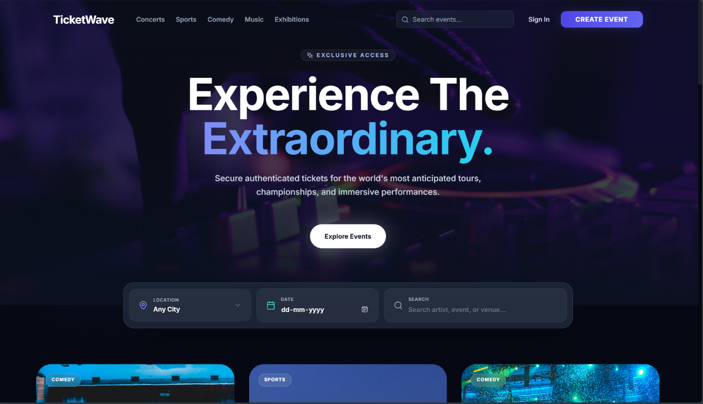
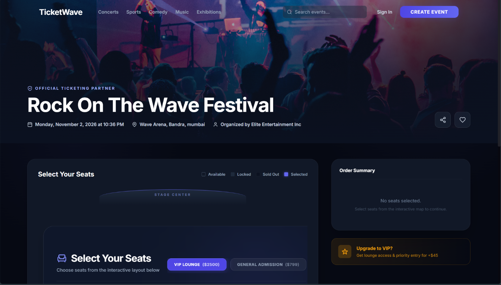
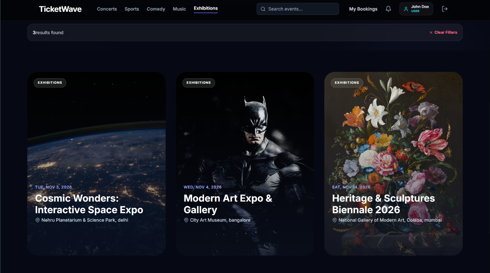

# TicketWave 🌊

TicketWave is a production-grade, real-time event ticketing platform similar to BookMyShow. It features JWT auth (with access token rotation), real-time seat locking, dynamic collaborative seat selection maps, booking history with QR code passes, and fully functional dashboards for event organizers and system administrators.

---

## Screenshots

### Home page


### Event details and seat selection


### Filtered events


---

## 🛠️ Tech Stack

### Backend
- **Core**: Node.js & Express.js
- **Database**: MongoDB (via Mongoose ODM)
- **Cache & Locks**: Redis (via `ioredis` with an automated in-memory fallback)
- **Real-Time Communication**: Socket.io
- **File Upload**: Multer (disk storage)
- **Ticket Verification**: QRCode npm package
- **Security**: Helmet, CORS, JWT authentication (Access & HTTP-only Refresh tokens)

### Frontend
- **Framework**: React 18 (Vite-scaffolded)
- **Styling**: Tailwind CSS
- **State & Caching**: TanStack React Query (v5)
- **Routing**: React Router DOM (v6)
- **Networking**: Axios (with custom authorization and refresh interceptors)
- **Icons**: Lucide React

---

## 📂 Project Structure

```text
TicketWave/
├── client/
│   ├── src/
│   │   ├── components/      # Reusable UI widgets (Navbar, ProtectedRoute)
│   │   ├── context/         # AuthContext session & notification managers
│   │   ├── hooks/           # Custom hook folders
│   │   ├── pages/           # Page routes (Home, EventDetail, BookingConfirm, etc.)
│   │   ├── services/        # Axios API instance with token refresh interceptor
│   │   ├── socket/          # Socket.io client setup
│   │   └── index.css        # Global CSS, gradients, and custom animations
│   ├── package.json
│   └── tailwind.config.js
│
└── server/
    ├── src/
    │   ├── config/          # DB connection & Environment validation
    │   ├── controllers/     # API logic handlers (Auth, Events, Bookings, Admin)
    │   ├── middleware/      # Auth, Role Checks, and Global Error handlers
    │   ├── models/          # User, Event, Booking, and Notification schemas
    │   ├── routes/          # Express route routers
    │   ├── services/        # Redis locking, Socket.io broadcasts, and QR generation
    │   └── scripts/         # Seed script
    ├── uploads/             # Event cover image disk uploads
    ├── index.js             # Main server entrypoint
    └── package.json
```

---

## ⚙️ Setup & Installation

### Prerequisite Checklist
- **Node.js**: v18.0.0+ (Tested on v22.17.0)
- **MongoDB**: Active instance on `localhost:27017`
- **Redis (Optional)**: Active on `localhost:6379`. If Redis is missing, the application automatically triggers an **In-Memory Cache & Lock fallback store** that replicates Redis functionality perfectly so that the server remains fully functional.

### Quickstart (Single Terminal from Root)
```bash
# 1. Install all dependencies (root, server, and client)
npm run install-all

# 2. Setup environment files
cp server/.env.example server/.env
cp client/.env.example client/.env

# 3. Seed database with fresh users & events (relative to current date)
npm run seed

# 4. Start both backend and frontend concurrently
npm run dev
```

### Manual Step-by-Step Setup
```bash
# Install server dependencies
cd server
npm install

# Install client dependencies
cd ../client
npm install
```

### Step 2: Configure Environment Variables
Copy the `.env.example` files to `.env` in both folders. The preconfigured defaults are ready to run:

**Server (`server/.env`):**
```ini
PORT=5000
MONGO_URI=mongodb://localhost:27017/ticketwave
REDIS_URL=redis://localhost:6379
JWT_SECRET=supersecret_ticketwave_access_token_12345
JWT_REFRESH_SECRET=supersecret_ticketwave_refresh_token_67890
CLIENT_URL=http://localhost:5173
```

**Client (`client/.env`):**
```ini
VITE_API_URL=http://localhost:5000/api
VITE_SOCKET_URL=http://localhost:5000
```

### Step 3: Seed the Database
Run the seed script in the server directory to clean the database and create default users and 5 premium events:

```bash
cd server
npm run seed
```

This creates the following demo accounts:

| Role | Email | Password |
| --- | --- | --- |
| Admin | `admin@ticketwave.com` | `password123` |
| Organizer | `organizer@ticketwave.com` | `password123` |
| User | `user@ticketwave.com` | `password123` |

> **Warning:** The seed script deletes existing users, events, bookings, and notifications. Run it only against a disposable development database, never production.

---

## 🚀 Running the Application

### 1. Start the API Server
In the `server/` directory, run:
```bash
npm run dev
```
The server will start on [http://localhost:5000](http://localhost:5000).

### 2. Start the Frontend Dev Server
In the `client/` directory, run:
```bash
npm run dev
```
Open [http://localhost:5173](http://localhost:5173) in your browser.

---

## 🔒 Seat Locking & Sockets logic

1. **Optimistic & Live Sockets**: Clicking a seat on the event page immediately fires a `lock-seat` socket request. The server locks the seat in Redis for 10 minutes (`EX 600 NX`).
2. **Real-time Synchronization**: All clients viewing the event receive a `seat-locked` socket event, turning the seat yellow/disabled on their layouts. If deselected, an `unlock-seat` event is broadcast.
3. **Double-Booking Prevention**: When creating the booking (`POST /api/bookings`), the backend double-checks MongoDB records and Redis locks. Overlaps return a `409 Conflict` error.
4. **Final Confirmation**: Authorizing checkout converts the lock to a MongoDB booking, decreases available seats, deletes Redis keys, and generates a ticket containing a verifiable QR code.
